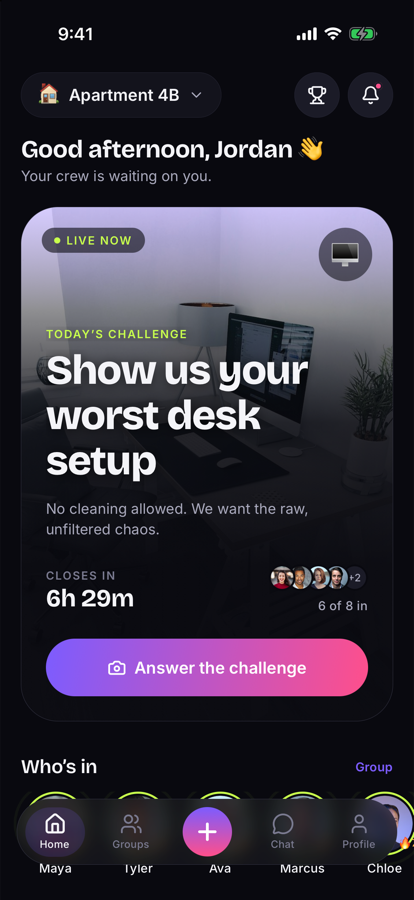
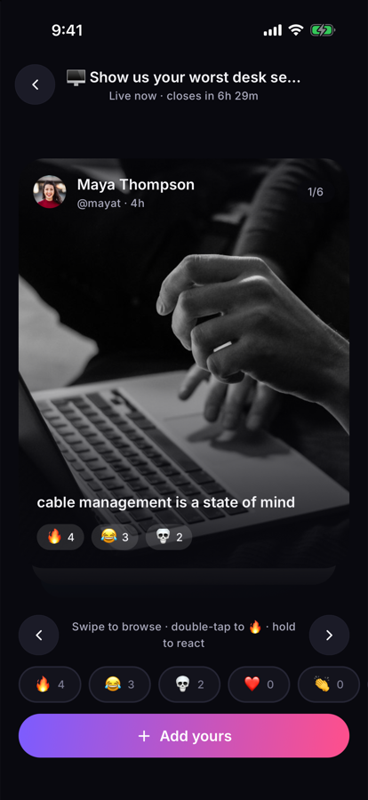
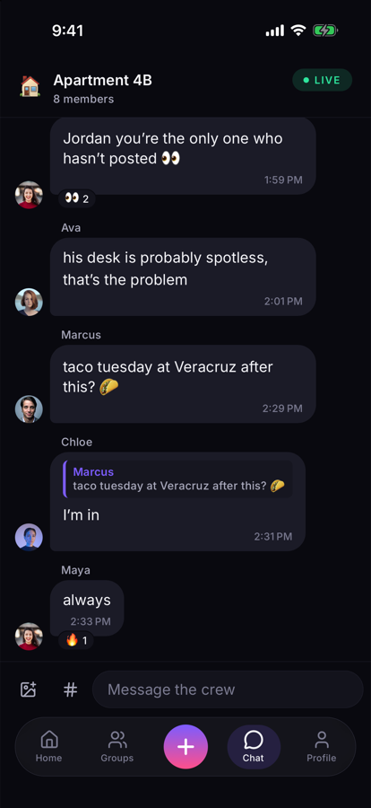
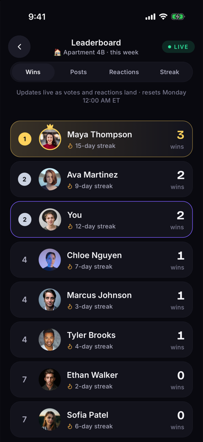
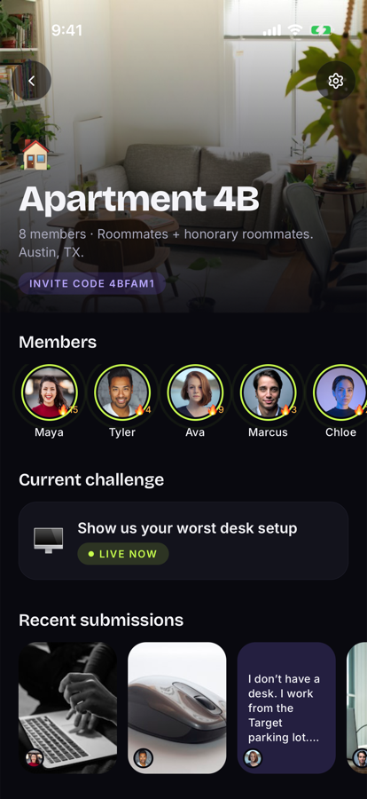
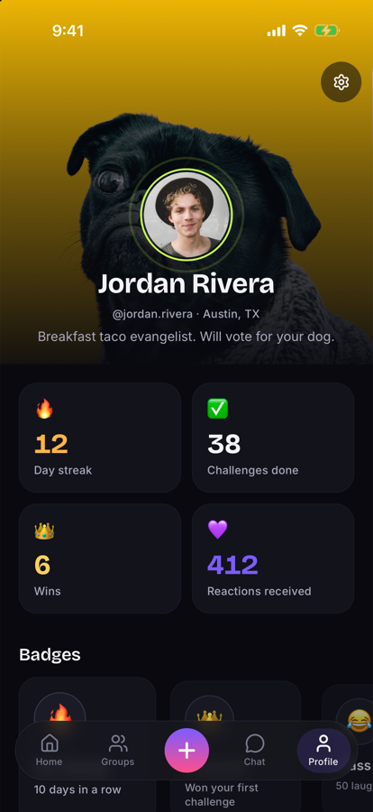
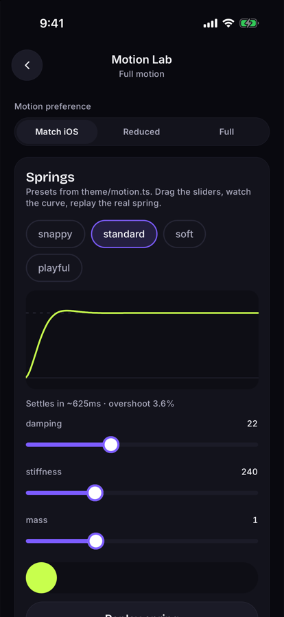

# PulseDeck

**PulseDeck is a motion-first social challenge app for close friend groups, built with React Native, Expo, TypeScript, React Reanimated, and Supabase. It explores how motion, gestures, realtime interaction, and UI systems can make lightweight social interactions feel playful and immediate.**

**▶ Live demo (real app in an iPhone frame):** https://pulsedeck-ten.vercel.app · **Launch film:** [`brag-output/brag.mp4`](brag-output/brag.mp4) (4K60) · [web cut](website/assets/pulsedeck-launch.mp4)

One prompt a day ("Show us your worst desk setup"). Post a photo, short video or hot take in about 30 seconds, swipe through your friends' responses, react, vote, chat, and keep the streak alive.

| Home | Swipe deck | Chat | Leaderboard | Group |
|---|---|---|---|---|
|  |  |  |  |  |

| Profile | Motion Lab |
|---|---|
|  |  |

*Screenshots are production renders from the iOS simulator (iPhone 17 Pro, Expo SDK 58), demo data.*

---

## Run it (free, about 2 minutes)

```bash
npm install
npx expo start          # press i for the iOS simulator, or scan the QR code with Expo Go
```

No backend setup is needed. Without Supabase keys the app runs on a built-in **demo backend**: in-memory data with simulated latency, realtime chat (friends type and reply), live leaderboard updates, and optional failure injection.

- Tap **Explore the demo crew →** to sign in as Jordan (Austin, TX) in the *Apartment 4B* group.
- Or create an account to go through onboarding. Demo invite codes: `4BFAM1`, `LUNCH7`, `GGWP42`.
- **Settings → Simulate flaky network** fails about 50% of requests so you can see retries, rollbacks, failed messages and the upload-failure state.
- `EXPO_PUBLIC_DEMO_AUTOLOGIN=1 npx expo start` skips the sign-in screen (used for screenshots and Maestro).

### With Supabase (free tier)
1. Create a project at supabase.com (free) or run `supabase start` locally (Supabase CLI + Docker).
2. Apply `supabase/migrations/*` and optionally `supabase/seed.sql` (demo users, password `pulsedeck123`).
3. `cp .env.example .env` and fill in `EXPO_PUBLIC_SUPABASE_URL` and `EXPO_PUBLIC_SUPABASE_ANON_KEY`.
4. Optional push: deploy `supabase/functions/notify-challenge` and add a Database Webhook on `notifications` INSERT. It uses Expo's free push service.

### Device builds
`eas.json` defines `development`, `preview` and `production` profiles (`npx eas-cli build --profile development`). Remote push and TestFlight need an Apple Developer account. Everything else runs in Expo Go.

---

## What's inside

| Area | Highlights |
|---|---|
| **Onboarding** | 7 steps (welcome → name/username → avatar → interests → join/create group → notifications → success), spring progress bar, direction-aware transitions, async username check, keyboard handling, coordinated exit into the app |
| **Daily challenge** | Hero card with 5 designed phases (upcoming, active, submitted, voting, completed), live countdown, "6 of 8 in" participation, pulse rings on who has posted |
| **Submission** | Photo / ≤15 s video / text. Camera or library. Live preview, caption, then *preparing → uploading % → processing → success / failure → retry* (media kept on failure) |
| **Swipe deck** | Physics card stack on the UI thread: follows the finger, velocity-aware commit, rubber-banding, swipe back to previous, double-tap 🔥, long-press reaction menu, tap to expand (shared-element style), accessible prev/next buttons |
| **Reactions & votes** | Optimistic with rollback, idempotent double-tap, one vote per challenge (vote moves), no self-votes |
| **Realtime chat** | Optimistic send with `clientId` reconciliation, failed → tap to retry, de-duplicated realtime echo, typing indicator, swipe-to-reply, emoji reactions, challenge references, photo sharing, reconnect backfill, keyboard-synced composer |
| **Groups** | Create, join by code, invite via share sheet, rename (optimistic), leave with confirm, member carousel, activity, challenge history |
| **Profiles** | Collapsing parallax header, rolling stat counters, snapping badge carousel, response grid |
| **Leaderboard** | Wins / posts / reactions / streak, live score events, rows physically reorder, digits roll, ▲▼ movement, podium styling |
| **Notifications** | Permission flow, per-group per-type preferences, local test notification that deep-links into the challenge |
| **Motion Lab** (`/dev/motion-lab`) | Every motion primitive with live tuning: spring curve plotter (damping/stiffness/mass), swipe threshold/velocity/rotation sliders, bursts, reorder, shared transition, counters, modals, loading states |

## Architecture

```
app/            Expo Router routes (thin)          src/theme/      tokens incl. motion.ts
src/components/ ui (17) · motion (13) · feature     src/features/   React Query hooks per domain
src/domain/     pure rules, unit tested             src/services/   Backend interface → demo | supabase
src/store/      Zustand (session, prefs, toasts)    supabase/       schema, RLS, RPCs, triggers, seed, edge fn
```

- **One data boundary.** Screens call feature hooks, hooks call the `Backend` interface, and only `services/supabase` touches Supabase.
- **Server state vs UI state.** React Query owns server data. Zustand holds only the session, selected group, motion preference, onboarding draft and notification preferences.
- **Optimistic UI** for messages, reactions, votes, group rename and profile, each with a defined rollback.
- **Security first.** RLS on all 14 tables, ownership from `auth.uid()`, membership via `security definer` helpers, server-side RPCs for join/create/vote, storage writes limited to the owner's folder.

Details: [architecture](docs/architecture.md) · [product rules](docs/product.md) · [decisions / ADRs](docs/decisions.md)

## Motion system

All timing lives in [`src/theme/motion.ts`](src/theme/motion.ts): four durations (130 / 190 / 270 / 420 ms), four springs (**snappy** for buttons, **standard** for cards, **soft** for modals, **playful** for reactions), gesture thresholds, and layout presets that collapse to fades under reduced motion. Screens never hard-code animation constants.

Motion primitives: `AnimatedPressable`, `MotionCard`, `AnimatedModal`, `AnimatedCounter`, `AnimatedListItem`, `SwipeDeck`, `ReactionBurst`, `AnimatedAvatar`, `CollapsibleHeader`, `MotionTabIndicator`, `AnimatedProgressBar`, `SharedMediaTransition`, `SpringGraph`.

Reduced motion = iOS setting **or** the in-app override (Settings / Motion Lab). It removes particles, parallax, rotation and slides, keeps fades, and keeps every action working. Full per-interaction spec: [motion-spec.md](docs/motion-spec.md).

## Quality

| Check | Result |
|---|---|
| `npm run typecheck` (strict + typed routes) | 0 errors |
| `npm run lint` (incl. React Compiler rules) | 0 problems |
| `npm test` | 55 tests passing · domain logic 98% statement coverage |
| `bash supabase/tests/verify.sh` | migrations + seed apply · 16/16 RLS/RPC/trigger checks pass |
| `npx expo export --platform ios` | builds · 9.3 MB (down from 14.4 MB after font subsetting) |

More: [test plan](docs/test-plan.md) · [performance](docs/performance.md) · [accessibility](docs/accessibility.md) · [measured metrics](docs/metrics.md) · Maestro flow in [`.maestro/core-loop.yaml`](.maestro/core-loop.yaml)

## Design

Dark-first palette (violet → pink "pulse" gradient, lime for live/streak), **Bricolage Grotesque** for display and **Inter** for UI (both free Google Fonts), a 4-pt spacing scale, and high-quality Unsplash photography. Tokens and component variants are in [design-system.md](docs/design-system.md).

## Tech
Expo SDK 58 · React Native 0.88 (New Architecture) · React 19.3 + React Compiler · TypeScript 6 (strict) · Expo Router 58 (protected routes, typed routes) · Reanimated 4.7 + Worklets · Gesture Handler 3.3 (hook API) · TanStack Query 5 · Zustand 5 · expo-image / expo-video / expo-image-picker / expo-haptics / expo-notifications / expo-blur / expo-linear-gradient · lucide icons · Supabase (Postgres, Auth, Realtime, Storage, Edge Functions, pg_cron) · Jest + Testing Library · Maestro. Everything is free or open source.

## Marketing site & launch film

- **`website/`** — static marketing site deployed on Vercel. The hero embeds the **actual app** (Expo web export of this repo, demo backend) in a CSS iPhone frame. An 8-step guided walkthrough drives it through a small `postMessage` bridge (`src/features/demo/webBridge.ts`), and `/#step-2` style links deep-link into any step. Spring tokens from `src/theme/motion.ts` are converted to CSS `linear()` easings so the site moves like the app.
  - Rebuild the embedded app: `bash website/build-demo.sh` (exports with `EXPO_WEB_BASE_URL=/demo`, renames `node_modules` asset paths that Vercel won't upload)
  - Deploy: `cd website && npx vercel deploy --prod`
- **`brag-output/`** — the 24 s launch film, made with Hyperframes: plan, brief, composition (`composition/index.html`), 4K60 master `brag.mp4`, poster and share copy. Narration is Kokoro TTS (local, free). The music, *Pulse Check*, is an **original score** synthesized for this film by `brag-output/music/compose.py` (120 BPM, every scene cut on a bar line, ducked under the voice).

## Next steps
- **Figma file:** generate Foundations / Components / Motion pages from `docs/design-system.md` and add Figma-vs-production comparisons. The Figma connector wasn't authorized in the build environment (see ADR-009).
- **Device measurements:** cold start, swipe FPS and chat latency on a physical iPhone, recorded in `docs/metrics.md`.
- Private media bucket with signed URLs (ADR-007), Apple Sign In (ADR-008), demo video recording, TestFlight build.
